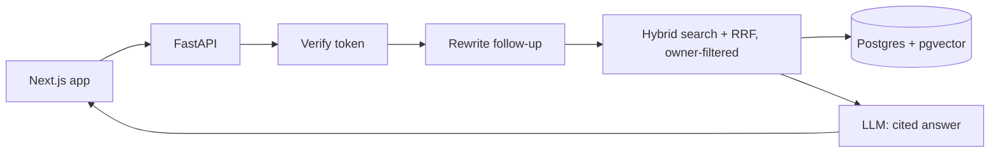

# Cognora

Upload a PDF, ask questions, get answers that **cite the pages they came from**. Each user has a private workspace.

Built as a learning project to understand RAG, AI agents and the security work around them.

## Features

- **Hybrid search**: vector (pgvector) plus keyword (Postgres full-text), merged with Reciprocal Rank Fusion
- **Cited answers**: `[1]` points to the exact passage and page; answers with no citation are replaced by a refusal
- **Follow-up questions**: conversations are stored in Postgres and follow-ups are rewritten into standalone questions
- **Two modes**: *Basic* (one search, fast) and *Agent* (the model chooses its own tool calls: search, read pages)
- **Accounts**: email and password login, private documents and chats per user
- **Guard rails**: only answers from your documents; tells you when it cannot find something

## Results

Measured on one 32-page syllabus with a 30-question set I wrote (`backend/tests/questions.json`). A question passes when one of the top 10 chunks contains all the required phrases. Small and single-document, so treat these as indicative.

| Version | Hit@1 | Hit@3 | Hit@5 | MRR |
|---|---|---|---|---|
| Fixed-size chunks | 18/30 | 24/30 | 27/30 | 0.714 |
| + section path in each chunk | 19/30 | 25/30 | 27/30 | 0.737 |
| **+ chunks break at headings (kept)** | 18/30 | **26/30** | **29/30** | 0.738 |
| + small reranker (removed) | 20/30 | 24/30 | 27/30 | 0.750 |

The reranker helped Hit@1 but hurt Hit@3 and Hit@5 and added about 0.9 s per search, so it was removed. Measure before you keep a component.

**Isolation eval** (`backend/eval_isolation.py`): two users with different documents ask the same questions, and every retrieved chunk is checked against its owner.

| Check | Leaked |
|---|---|
| Normal search (255 chunks checked) | 0 |
| Search aimed at the other user's document ids | 0 |
| Agent page-read tool aimed at the other user's documents | 0 |
| Same test with the owner filter deliberately broken | 405 |

The last row shows the test can actually fail.

## How it works



**Upload:** PDF → text per page → remove repeated headers and footers → detect headings from font size and bold → chunks of about 300 tokens that start at headings, with overlap → embeddings (`bge-small-en-v1.5`, run locally) → Postgres. Each chunk stores its section path.

**Agent mode:** the model can call `search_documents` and `read_pages`, up to 3 steps and 4 calls per step. If it returns malformed tool output, the request falls back to the basic pipeline.

## Security

| Area | What is in place |
|---|---|
| Passwords | Argon2 hashing, 10 to 128 characters, same error for wrong email or password, dummy hash against timing leaks |
| Sessions | Signed JWT with 30-minute expiry; `exp`, `iat` and a UUID `sub` are required |
| Brute force | 5 failed logins per email and 20 per IP in 15 minutes; 5 sign-ups per IP per hour |
| Data isolation | Every route needs a token; every query (documents, search, chunks, conversations, messages, agent tools) filters by `owner_id`; other users' ids return 404 |
| Uploads | 25 MB, PDF header check, at most 150 pages, 5 documents per user, duplicate files stored once |
| AI | Document text treated as untrusted (prompt injection), off-document questions refused, citations required, agent step and call limits |
| Web | Explicit CORS origins, parameterised SQL, answers rendered as plain text (no raw HTML) |

## Stack

| | |
|---|---|
| **Backend** | Python, FastAPI, Pydantic, PyMuPDF |
| **Data** | PostgreSQL (Neon), pgvector, full-text search |
| **Embeddings** | `BAAI/bge-small-en-v1.5` (384 dimensions), local |
| **LLM** | OpenAI-compatible client via OpenRouter |
| **Auth** | argon2-cffi, PyJWT |
| **Frontend** | Next.js (App Router), TypeScript, Tailwind, designed in Figma |
| **Deploy** | Docker Compose, Caddy (automatic HTTPS), AWS EC2 |

## Run locally

Needs Python 3.10+, Node 18+, a free [Neon](https://neon.tech) database and an OpenRouter (or compatible) API key.

```bash
# backend/.env
DATABASE_URL=postgresql://...?sslmode=require
LLM_API_KEY=...
LLM_BASE_URL=https://openrouter.ai/api/v1
LLM_MODEL=provider/model-name
JWT_SECRET=...        # python -c "import secrets; print(secrets.token_hex(32))"
ALLOWED_ORIGINS=http://localhost:3000
```

```bash
cd backend
python -m venv .venv && source .venv/Scripts/activate      # Windows Git Bash
pip install -r requirements.txt
python run_sql.py schema_v2.sql && python run_sql.py schema_v3.sql
python run_sql.py schema_v4.sql && python run_sql.py schema_v5.sql
python -m uvicorn app.main:app --reload

cd ../frontend          # .env.local: NEXT_PUBLIC_API_URL=http://localhost:8000
npm install && npm run dev
```

Open `http://localhost:3000`. Evaluate with `python eval_retrieval.py` and `python eval_isolation.py` (the second needs two users who each have a ready document).

## Deploy

One server runs three containers: Caddy (HTTPS, routes `/api/*` to the backend and everything else to the frontend), the backend and the frontend. Same origin, so no CORS or cookie problems. Set `DOMAIN` in `.env`, create `backend/.env.production` on the server with `APP_ENV=production`, then:

```bash
docker compose up -d --build
```

## Project structure

```
backend/
  app/        main.py  auth.py  ingestion.py  search.py  answer.py
              agent.py  tools.py  memory.py  db.py
  tests/      questions.json
  eval_retrieval.py   eval_isolation.py
frontend/
  app/        page.tsx (workspace)  login/  register/  api.ts
  components/ auth-card.tsx
```

## What I learned

- Chunking by section matters more than a fancier model or a reranker.
- Hybrid search plus rank fusion beat vectors alone.
- A security rule you have not tested can quietly break, so measure it: the isolation eval catches a deliberately broken filter.
- A "CORS error" can hide a server crash. Read the server traceback first.

## Limits and roadmap

- Evaluated on one document; a second, different document is the next check.
- No OCR for scanned PDFs, no password reset or email verification, token is kept in `sessionStorage` (httpOnly cookie planned once frontend and API share a domain).
- Planned: document delete button, daily question limit per user, MFA, saved-chat list.
